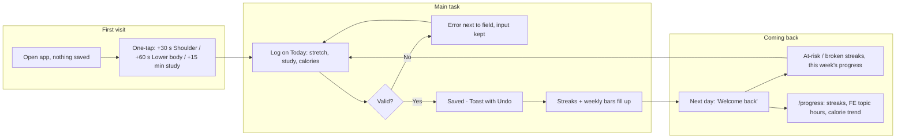

# Routine Tracker

A daily tracker for one person's routine: **shoulder and lower-body stretching**, **FE Mechanical exam study** (time per NCEES topic), and **net calories**. It saves to the browser (localStorage), so it remembers you on the device you use.

Built for *Design, Build, Ship* (MPCS 51238), Assignment 3: Patterns & Flows.

- **Live:** https://dbs-assignment3-zeta.vercel.app
- **Code:** https://github.com/phamkd17/DBS-Assignment3
- **Stack:** Next.js, Tailwind CSS, localStorage. No database, accounts, or APIs.

## Who it's for and why you come back

It's built for me: I'm studying for the FE Mechanical exam and want to keep up a short daily stretching habit. The reason to come back is **streaks and visible progress**:

| Routine | Daily streak | Weekly streak |
|---|---|---|
| Shoulder stretch | ≥30 s that day | ≥10 min, Sun–Sat |
| Lower-body stretch | ≥30 s that day | ≥10 min, Sun–Sat |
| FE study | ≥15 min (15 Bronze · 30 Silver · 60 Gold) | Goal: 420 min, Sun–Sat (progress bar, no streak) |
| Calories | none: net total and trend only | n/a |

**Why 10 minutes per week?** Ingram et al. (*Sports Medicine*, 2024; 189 studies) found that static-stretching flexibility gains plateau at about 4 min per session and about 10 min per week per muscle group. The daily 30-second streak builds the habit, and the weekly streak tracks the dose that actually matters.

## Flows

**Main task:** I log a stretch, my study minutes, and what I ate → today's streaks and weekly bars fill up → I come back tomorrow, my streaks are still alive, and my FE topic hours keep growing.

Full diagrams with all states and errors are in [flows.md](flows.md).



## Onboarding research

I sent three subagents to study how similar tools welcome someone new: the first screen, what it asks for, and how soon you get something useful.

| | **Duolingo** (streaks) | **Lose It!** (calorie logging) | **Bend** (stretching) |
|---|---|---|---|
| First screen | Mascot + one-line pitch + "Get Started" | Goal-driven setup (exact first screen unverified) | Welcome + "Get Started" |
| Asks before value | ~6 questions: goal, daily minutes, level | Long profile: weight, goal, activity, sign-up | 16–20-step quiz, rating prompt, 2 paywalls |
| Time to first value | ~1.5–3 min | "Within minutes"; 45–90 s per meal | ~2 min before the first stretch |
| Sign-up | After the first lesson | Up front | After the first workout |
| Return hook | Instant "1-day streak!", milestone celebrations, Streak Freeze | Quick Add, recent foods | Day streak + "Bendometer" consistency score |

**Pattern:** the best experiences let you *do the thing* before asking anything. All three add friction to sell subscriptions; this tool has no account or paywall, so it can skip straight to logging.

**What I'm using**
- **Ask nothing first** (Duolingo, Bend): the first screen is one-tap log buttons (+30 s Shoulder, +60 s Lower body, +15 min study). No questions, no setup.
- **Celebrate the first log** (Duolingo): the first tap immediately shows "1-day shoulder streak!", with bigger moments saved for 7 and 30 days.
- **Calorie Quick Add** (Lose It!): just a number + optional label, with an Eaten / Burned toggle. Net is shown without a budget or "calories remaining."

**What I'm not using**
- Long questionnaires, rating prompts, paywalls (all three).
- Streak Freeze (Duolingo): I kept the strict rule (miss a day and that region resets). Logging for a past date (calendar picker) already covers forgetting to log.
- Recent-entry chips, meal tags, consistency score: left out to keep it simple.

Sources: [Duolingo blog: streak habit](https://blog.duolingo.com/how-duolingo-streak-builds-habit/) · [Duolingo blog: improving the streak](https://blog.duolingo.com/improving-the-streak/) · [Gummble: Duolingo onboarding](https://gummble.com/blog/duolingo-onboarding-flow-analysis) · [Appcues GoodUX: Duolingo](https://goodux.appcues.com/blog/duolingo-user-onboarding) · [RevenueCat: Lose It! onboarding length](https://www.revenuecat.com/blog/growth/why-your-onboarding-experience-might-be-too-short) · [Lose It! review](https://calorie-trackers.com/reviews/lose-it/) · [ScreensDesign: Bend flow](https://screensdesign.com/showcase/stretching-flexibility-bend) · [Pratt IxD: Bend critique](https://ixd.prattsi.org/2024/09/design-critique-bend/) · [Bustle: Bend review](https://www.bustle.com/wellness/bend-stretching-app-review-price-features-subscriptions)

## Accessibility check

Checked with my agent on Oct 17, 2026, against WCAG 2.1 AA.

**Automated scan (axe-core):** all 5 pages, both empty (first visit) and with 30 days of data, with every collapsible section open. The first run found 3 issues, all fixed; the final run is **0 violations on all 10 page states**.
- Study quick-add chips had an accessible name ("Add 1 minute") that didn't match the visible text ("+1 min"). Removed the extra label.
- Chart day columns used `aria-label` without a role. They now use `role="img"`.
- "Show as table" scroll areas couldn't be reached by keyboard. They're now focusable, named regions.

**Keyboard:** I tabbed through every page in a real browser. Every control is reachable in a logical order, and every stop shows a visible saffron focus ring.
- "Skip to content" is the first stop.
- Pill choices (Eaten/Burned, Region, Day) are native radio groups: one Tab stop, then arrow keys.
- Each chart is one Tab stop: arrow keys move a day, Page Up/Down a week, and the tooltip shows on focus as well as hover.
- The calendar date picker works with arrows, Home/End, and Page Up/Down.
- Collapsible sections use native `<details>`.

**Labels:** every input has a real `<label>`; pill groups use `<fieldset>` + `<legend>`. Errors are tied to their fields with `aria-describedby` and `aria-invalid`, and focus moves to the first invalid field.

**Text contrast** (computed, including semi-transparent text blended onto its background):

| Pair | Ratio | Needs |
|---|---|---|
| Body text (cream) on card | 14.1:1 | 4.5:1 |
| Secondary text (linen) on card | 11.4:1 | 4.5:1 |
| Hints / muted text on card | 8.4:1 | 4.5:1 |
| Small muted 70% text (12px) | 4.8:1 | 4.5:1 |
| Link (caramel) on card | 5.7:1 | 4.5:1 |
| Error text (rose) on card | 6.4:1 | 4.5:1 |
| Primary button (espresso on saffron) | 8.4:1 | 4.5:1 |
| Selected pill (cream on claret) | 8.7:1 | 4.5:1 |
| Chart label (dark ink on saffron) | 5.6:1 | 4.5:1 |
| Input border vs card (UI) | 3.6:1 | 3:1 |
| Focus ring vs page (UI) | 8.4:1 | 3:1 |
| Placeholder example text (muted 75%) | 4.8:1 | 4.5:1 |

Placeholder hints ("e.g. 250") started at 3.6:1 because I'd asked for them dimmer. I raised them to 4.8:1 so they pass AA and still read lighter than typed text (12.3:1).

**Charts:** colors were checked with a palette validator for colorblind (protan/deutan) and normal-vision separation on the dark card. Taupe can't be told apart by color alone, so taupe series always get a checker pattern. Every chart has a "Show as table" view, so no value depends on color or hover.

**Also:** respects "reduce motion"; warns when the browser blocks storage (private mode), so entries aren't silently lost.

## First-run check (agent usability feedback)

On Oct 17, 2026, I gave a fresh agent (no knowledge of the project or code) the live URL and this goal: *"Log a shoulder stretch, 15 minutes of Statics, and a 650-calorie lunch. Then come back tomorrow and see if it remembers me."* It used a real browser at phone size (390×844), took screenshots at each step, faked "tomorrow" by shifting saved dates back a day, and did a quick keyboard pass.

**First impression (agent's words):** "Warm and readable. 'Start here' with three one-tap buttons told me what to tap first. Nothing says what the app is for, though, and a first-timer sees '−14,139 kcal' this week before logging anything, which is alarming."

**What worked**
- One tap logged a stretch: "1-day shoulder streak!" with Undo.
- Study: "Logged 15 min Statics · Bronze day · 1-day streak".
- Form errors sit under the field, say what to do ("Enter calories as a whole number, like 250."), keep what was typed, and move focus there. "Pick a topic first." appears when a topic is missing.
- Detail pages have a clear "‹ Today" back link and a History with Delete.
- **Coming back:** "Yes, it remembered me." Welcome back listed exactly what to do today ("Stretch 30 s of shoulder to keep your 1-day streak…").
- Focus is visible on every element, and Tab order is logical.

**Friction and bugs it found**
1. **Bug: focus hidden under the bottom nav.** Tabbing down the page, the focused button sat behind the fixed nav bar.
2. **Bug (possible): taps landing on the nav.** On /calories, a button near the bottom could sit behind the nav.
3. **Start here vanishes after the first tap**, so the other two "wins" are gone before you can tap them.
4. **Welcome back has no action buttons.** It says what to do, but you still have to scroll to do it.
5. **Body burn surprises new users.** 2,052 kcal/day is subtracted without asking, and the week counts days before you started (−14,139 kcal on day one).
6. **"Custom ▾" in Calories reads like a calorie type**, not "more options" (label, date).
7. **Progress opens with the calorie chart**; streaks are near the bottom.
8. Bronze/Silver/Gold isn't explained on Today. Toasts can cover content under them.

**Its top 5 recommendations:** (1) keep Start here until all three wins are done, (2) add one-tap buttons to Welcome back, (3) confirm body burn and count it only from the first day used, (4) add padding so the nav never covers focused or primary buttons, (5) rename "Custom ▾" in Calories and move Streaks up on Progress.

**What I changed**
- **Fixed both nav bugs (#1, #2):** the page now scrolls focused and tapped elements clear of the fixed bottom nav (and the sticky top nav on wider screens). Re-tested: 0 of 25 focused controls are covered.
- **Body burn starts on your first calorie log (#5):** no burn is counted before you start tracking, so day one shows your real net instead of −14,139 kcal. The week total and average only count days since you started.
- **Explained tiers on Today (#8):** the FE study card now says "Bronze 15 · Silver 30 · Gold 60".
- **"Custom ▾" in Calories is now "More ▾" (#6),** so it reads as more options, not a calorie type.

**What I kept, and why**
- **Start here disappears after the first tap (#3).** Its job is to get you to log *something* right away. After that, the regular cards are right there.
- **No buttons in Welcome back (#4).** It's a quick reminder, and the quick-log chips are one card below it.
- **Progress opens with the calorie trend (#7).** That's the chart I check most; Streaks still has its own section.

## Run locally

```bash
npm install
npm run dev
```
