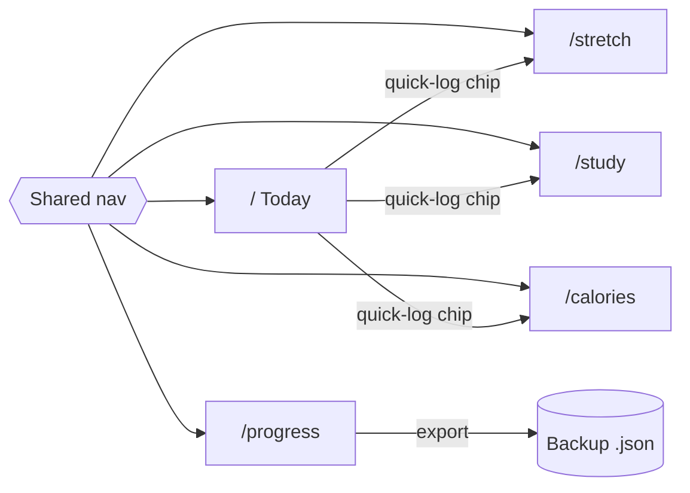
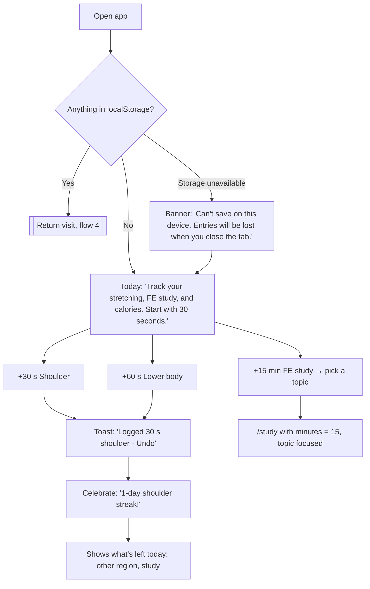
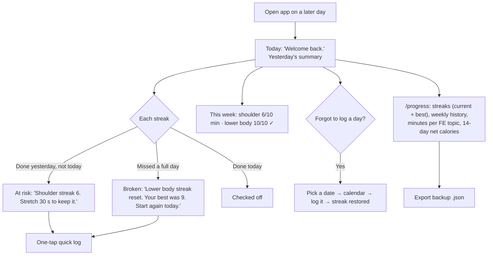

# Flows

**Main task, in one sentence:**

> I log a stretch, my study minutes, and what I ate → today's streaks and weekly bars fill up → I come back tomorrow, my streaks are still alive, and my FE topic hours keep growing.

## 1. Map: pages and shared navigation

Every page is a route and shares the same nav, so you can always get back to Today.

## 2. First visit: useful right away

Nothing is saved yet. Instead of an empty screen or a tour, Today offers one-tap actions, and the first tap starts a streak.

## 3. Main task: log an entry (form + errors)

All three forms share the same `Field`/`Input`/`Button` components and the same validation pattern.

## 4. Coming back: it remembers

